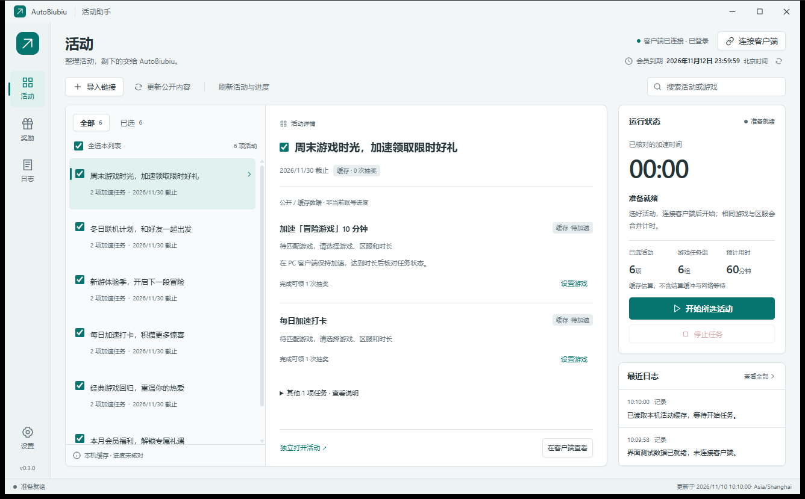

# AutoBiubiu

**Biubiu 加速器自动做活动的 Windows 桌面助手。**

基于 Tauri 2、Rust、Svelte 5 和 TypeScript，整理活动、合并同一游戏与区服的任务、累计实际加速时长，并核对领取与抽奖结果。实际游戏加速由本机 biubiu 客户端完成，本项目不是加速器本体。



截图来自隔离桌面测试；活动、会员时间和日志均为合成演示数据。

## 功能与边界

- 读取客户端活动中心、导入官方活动链接，区分公开规则、缓存信息与已核对的账号进度。
- 自动执行可识别的 PC 加速时长任务，支持游戏、区服和时长设置；邀请、绑定、手机加速等任务仅展示说明。
- 按游戏与区服合并任务，每 5 秒核对实际加速状态；达标后等待 20 秒结算，再读取服务端状态。
- 展示奖励、执行日志及北京时间的会员到期时间；支持搜索、筛选、浅色/深色主题和托盘运行。
- 领取或抽奖结果不明时保留待核对记录，不自动重复提交。最终是否达标、获得奖励，以官方活动服务返回为准。

## 从源码启动

需要 Windows 10/11、已安装并登录的 biubiu PC 客户端，以及以下开发环境：

| 依赖 | 要求 |
| --- | --- |
| Node.js | 22.12.0 或更新版本，包含 npm |
| Rust | 1.85 或更新版本，MSVC 工具链；建议使用当前 stable |
| Visual Studio Build Tools | C++ 桌面开发工作负载与 Windows SDK |
| Microsoft Edge WebView2 | 桌面应用运行时 |

```powershell
git clone https://github.com/a08381/AutoBiubiu.git
Set-Location AutoBiubiu
npm ci
npm start
```

`npm start` 启动完整 Tauri 开发版；`npm run dev` 仅启动前端预览，没有桌面 IPC，不能操作客户端。

也可双击 [Start-AutoBiubiu.cmd](Start-AutoBiubiu.cmd)：优先启动 debug/release 中修改时间较新的 EXE，时间相同优先 release；尚无 EXE 时回退到开发模式。直接运行已构建的 EXE 不需要 Node.js 或 Rust。

发行版启动时会请求 UAC 管理员确认；开发版仅在启动客户端需要提权时请求。客户端识别与连接由 Rust 和 Windows API 实现，不需要外置连接脚本。

## 使用流程

1. 启动后打开 **设置 → biubiu 客户端**，确认安装目录或完整 EXE 路径、调试端口，点击 **保存客户端设置**。默认端口为 `9222`，仅连接本机 `127.0.0.1`；识别和保存不会启动客户端。
2. 点击右上角 **连接客户端**，按需完成 UAC 确认。若现有客户端需要重启以启用调试，会先弹出确认；重启会中断当前加速。
3. 点击 **刷新活动与进度** 读取账号状态。**更新公开内容** 只读取公开规则，不能代替账号进度核对；也可使用 **导入链接** 添加活动。
4. 勾选活动，在详情中设置 PC 游戏、区服和时长，点击 **开始所选活动**。运行中可随时点击 **停止任务**；待核对记录应先在官方页面确认，再点击 **已核对，重新读取**。
5. 关闭窗口会收起到托盘，后台队列继续运行。完全退出请用 **设置 → 退出应用** 或托盘菜单 **退出**，应用会处理任务停止和记录保存。

搜索和筛选不会清空选择，“全选本列表”只影响当前可见活动。运行任务、处理请求或存在待核对记录、遗留加速时，客户端配置保持锁定。切换账号或会员信息变化后，可点击会员到期时间旁的刷新按钮。

## 数据与配置

默认数据目录是 **EXE 所在目录下的 `data\`**，不是固定的源码根目录。可通过 **设置 → 本机记录目录 → 打开目录** 或奖励/日志页的 **打开记录目录** 找到实际位置。

| 文件 | 内容 |
| --- | --- |
| `settings.json` | 客户端路径与调试端口 |
| `activities.json` | 活动缓存 |
| `mappings.json` | 游戏、区服与时长配置 |
| `run.json` | 执行状态、奖励与待核对记录 |
| `events.jsonl` | 事件与连接诊断日志 |

应用不保存账号密码；Cookie、CSRF 令牌与客户端会话只驻留后端内存，日志写入前会过滤敏感字段。奖励记录可能包含兑换信息，**不要将自己的数据目录提交到仓库或随安装包公开分发**。迁移个人数据时，应先完全退出应用，再备份整个数据目录。

| 环境变量 | 用途 |
| --- | --- |
| `AUTOBIUBIU_DATA_DIR` | 指定数据目录 |
| `AUTOBIUBIU_CDP_PORT` | 尚无设置文件时的默认端口，已有设置优先 |
| `AUTOBIUBIU_LEGACY_DATA_DIR` | 指定首次迁移来源 |

首次迁移仅在目标目录不存在时复制上表五个文件，不删除来源、不覆盖已有目标。迁移来源优先使用显式环境变量，再检查 `%APPDATA%\AutoBiubiu\data`；否则开发版使用源码根目录的旧数据，发行版使用 EXE 旁的历史数据。[启动脚本](scripts/launch.ps1)会显式指定源码根目录的旧数据作为迁移来源。

## 构建与验证

```powershell
npm run build                 # 类型检查并构建前端
npm test                      # 前端与 Rust 单元测试
npm run pack                  # 构建 release EXE
npm run dist                  # 构建 NSIS 安装包
```

| 命令 | 产物或用途 |
| --- | --- |
| `npm run check` | Svelte / TypeScript 检查 |
| `npm run test:frontend` | Vitest 前端测试 |
| `npm run test:rust` | Cargo 后端测试 |
| `npm run build` | 前端产物 `build\`，不是独立桌面应用 |
| `npm run pack` | `src-tauri\target\release\autobiubiu.exe` |
| `npm run dist` | `src-tauri\target\release\bundle\nsis\` 下的安装包 |
| `npm run build:icons` | 重新生成受版本控制的 PNG / ICO 图标 |

NSIS 安装范围为当前 Windows 用户，必要时下载 WebView2 bootstrapper；目前产物未配置代码签名。依赖版本由 [package-lock.json](package-lock.json) 与 [Cargo.lock](src-tauri/Cargo.lock) 固定，二者都应提交。

桌面冒烟测试需要已构建的 EXE。先关闭已有 AutoBiubiu 实例；测试 release 版本时使用管理员终端：

```powershell
npm run test:desktop
# 或指定另一个构建：
node scripts\smoke-desktop.js C:\path\to\autobiubiu.exe
```

测试使用隔离数据，检查真实 IPC、导航、主题、搜索、勾选、布局、设置保存、托盘、单实例和退出保存；不连接 biubiu，也不执行加速、领取或抽奖。报告与截图写入新建的 `data\tauri-smoke-*\`，不会提交到仓库。本地测试通过不代表真实账号或远端活动已验证。

辅助脚本测试：

```powershell
powershell.exe -NoProfile -File test\launch.test.ps1
pwsh -NoProfile -File test\cleanup-profile.test.ps1
```

旧 Electron 配置归档工具及其测试需要 PowerShell 7.2+，应用本身不需要它。工具默认只预览，使用 `-Apply` 才归档；保留业务数据与当前 Tauri WebView 配置，使用说明见 [Clean-AutoBiubiuProfile.ps1](scripts/Clean-AutoBiubiuProfile.ps1)。

## 常见问题

| 现象 | 处理方式 |
| --- | --- |
| 浏览器预览提示桌面功能不可用 | 使用 `npm start` 或构建后的 EXE，不是 `npm run dev` |
| 没有识别到客户端 | 在设置中浏览安装目录或填写 `biubiu.exe` 完整路径，保存后重新连接 |
| 连接失败或端口占用 | 检查日志页与 `events.jsonl`，核对调试端口、UAC 和客户端页面就绪状态 |
| 任务计时不增长 | 核对实际客户端的游戏、区服和加速状态；程序仅累计已确认的加速区间 |
| 领取/抽奖处于待核对 | 先在官方页面核对结果，再重新读取，避免重复操作 |
| 关闭窗口后仍在运行 | 关闭按钮是收起到托盘，使用设置页或托盘菜单退出 |

需要定位连接过程时，可使用可选的诊断脚本：

```powershell
powershell.exe -NoProfile -File scripts\diagnose-client-start.ps1 -Executable src-tauri\target\debug\autobiubiu.exe -Port 9222
```

该脚本启动指定 EXE、点击一次连接并检查页面状态；不会代为确认 UAC 或客户端重启，也不执行活动任务，结束后保留窗口。它不是应用运行依赖。

## 项目结构

| 目录 / 文件 | 用途 |
| --- | --- |
| [src/](src/) | Svelte 界面、IPC 封装与前端数据类型 |
| [src-tauri/src/](src-tauri/src/) | Rust 后端、任务队列、客户端连接与本地存储 |
| [src-tauri/tauri.conf.json](src-tauri/tauri.conf.json) | 桌面窗口与安装包配置 |
| [scripts/](scripts/) | 构建、启动、诊断与隔离验证工具 |
| [test/](test/) | 前端与 PowerShell 测试；Rust 测试位于各模块内 |
| [assets/](assets/) | 应用图标，构建时必需 |
| [docs/protocol.md](docs/protocol.md) | 架构、数据流与协议说明 |

[.gitignore](.gitignore) 排除依赖、构建产物、本地数据、历史研究样本、日志和本地凭据配置；源码、图标、测试与锁文件保持受版本控制。

## 许可证

本项目源码采用 [MIT License](LICENSE)，Copyright (c) 2026 a08381。第三方依赖、biubiu 客户端及其名称和服务不包含在本项目的 MIT 授权中。
