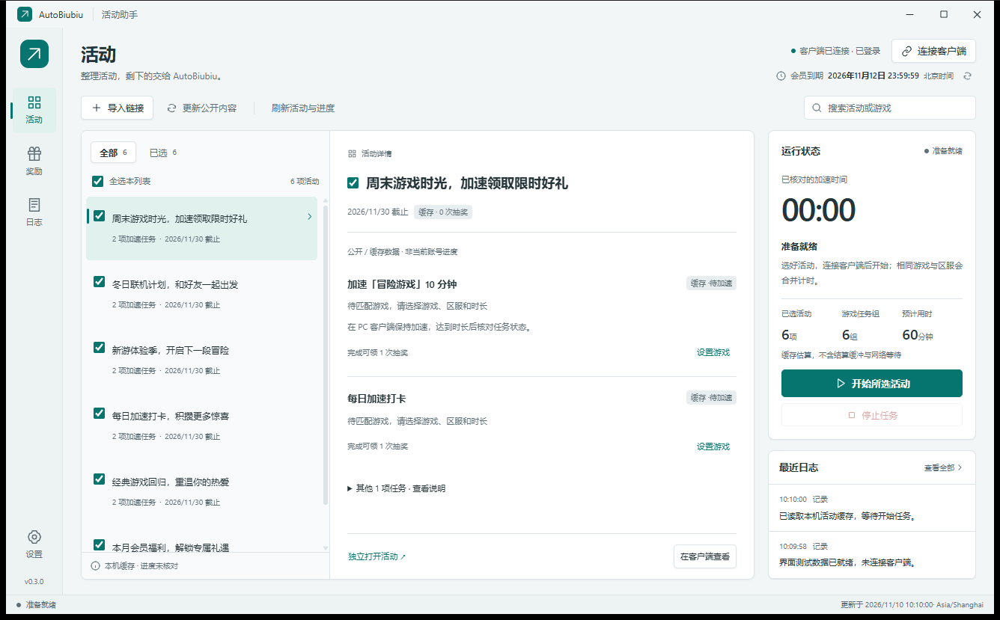

# AutoBiubiu

AutoBiubiu 是一个 Windows 桌面工具，帮你自动完成 biubiu 加速器活动里的“加速 N 分钟”任务。选好活动和游戏后，它会替你开加速、计时，时长够了就领取奖励、抽奖。

## 功能

- 读取 biubiu 客户端活动中心里的活动，也可以粘贴官方活动链接导入。
- 自动完成 PC、PS、Xbox、Switch 和 Steam Deck 平台的加速时长任务，同一游戏、同一区服的任务一起计时。
- 时长达标后自动领取奖励，并用掉已有的抽奖次数。
- 保存获得的奖励和执行日志，显示会员到期时间。
- 可设置任务完成后自动关机，以及关闭窗口时进入后台或直接退出，支持浅色和深色主题。
- 有新版本时在窗口顶部提示。

## 下载安装

运行前需要准备好：

- Windows 10 或 Windows 11
- 已安装并登录的 biubiu PC 客户端
- Microsoft Edge WebView2 运行时

安装步骤：

1. 打开 [Release 页面](https://github.com/a08381/AutoBiubiu/releases/latest)，下载 `AutoBiubiu_<版本号>_portable.zip`。
2. 解压到任意文件夹，双击其中的 `AutoBiubiu.exe`。
3. Windows 弹出管理员确认时，点击“是”。

升级时先退出旧版，再用新的 `AutoBiubiu.exe` 覆盖旧文件，同一文件夹里的其他内容不用动。

## 使用方法

1. 打开 **设置**，在 **biubiu 客户端** 一栏确认客户端的安装位置（没识别到时可以手动选择安装目录），点击 **保存客户端设置**。
2. 点击右上角的 **连接客户端**。如果 biubiu 已经在运行，可能需要重启它，重启前会弹窗询问；重启会中断正在进行的加速。
3. 点击 **刷新活动与进度**，读取活动和你的账号进度。
4. 在左侧勾选要做的活动，在右侧详情里为每个加速任务选好游戏、区服和时长。
5. 点击 **开始所选活动**。想中途结束时，点击 **停止任务**。
6. 在 **奖励** 和 **日志** 页面查看结果。

另外几点：

- **设置 → 关闭窗口时** 默认选择进入后台，收起到托盘并继续任务；可改为直接退出，任务仍在执行时会弹窗确认。也可使用 **设置 → 退出应用** 或托盘菜单里的 **退出**。
- **设置 → 任务完成后自动关机** 默认关闭。开启后，所选任务正常执行完成、停止加速并保存记录，再调用 `shutdown.exe /s /t 30`，30 秒后关机；手动停止、执行出错或仍有任务未执行时不触发。启动关机后，页面顶部会显示倒计时横幅，可点击 **取消关机** 调用 `shutdown.exe /a`；取消仅对本次关机生效，不会关闭自动关机设置。
- 出现“有一笔操作结果待核对”时，先到官方活动页查看任务状态和“我的奖励”，再点击 **已核对，重新读取**。
- 手机加速、邀请好友、绑定账号这类任务需要你自己完成，AutoBiubiu 只显示任务说明。

## 更多文档

- [biubiu 客户端协议](docs/protocol.md)
- [架构说明](docs/architecture.md)
- [活动服务与任务执行](docs/activity.md)
- [记录与配置文件](docs/data.md)
- [开发者说明](docs/development.md)
