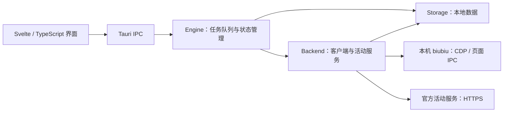

# 架构说明

本文描述 AutoBiubiu 的组件职责、桌面命令与应用更新检测。与 biubiu 客户端的交互见 [biubiu 客户端协议](protocol.md)，活动服务与任务执行见 [活动服务与任务执行](activity.md)，本地文件见 [记录与配置文件](data.md)。调整实现时同步更新相应测试。

## 组件与入口

| 模块 | 职责 |
| --- | --- |
| [前端 IPC](../src/lib/ipc.ts) | 调用桌面命令，在普通浏览器中明确报错 |
| [桌面入口](../src-tauri/src/lib.rs) | 窗口、托盘、单实例、数据目录与命令注册 |
| [任务引擎](../src-tauri/src/engine.rs) | 串行执行、计时、停止、领取、抽奖及待核对状态 |
| [客户端后端](../src-tauri/src/backend.rs) | CDP 会话、客户端 IPC、活动 HTTPS 请求 |
| [平台集成](../src-tauri/src/client_platform.rs) | 安装识别、Windows 原生进程启动与按需提权 |
| [客户端设置](../src-tauri/src/client_settings.rs) | 安装路径与调试端口的校验和持久化 |
| [会员解析](../src-tauri/src/membership.rs) | 会员到期时间与会员类型 |
| [领域规则](../src-tauri/src/domain.rs) | 活动链接、任务解析、计划合并与有效计时 |
| [任务租约](../src-tauri/src/lease.rs) | 协调客户端占用与并发请求 |
| [持久化](../src-tauri/src/storage.rs) | 文件锁、串行写入、原子替换、日志过滤与旧数据迁移 |
| [更新检测](../src-tauri/src/updates.rs) | 读取 GitHub 最新正式 Release 并比较版本 |

应用没有 Electron 主进程或本地 Node HTTP 服务。Node.js 仅用于开发、构建与测试；发行版的客户端连接不依赖 PowerShell 或旁置脚本。

| 桌面命令 | 行为 |
| --- | --- |
| `get_state` | 获取当前快照，不隐式连接客户端 |
| `check_update` | 独立读取 GitHub 最新正式 Release，与应用版本比较，缓存一小时 |
| `open_latest_release` | 打开固定的 AutoBiubiu 最新 Release 页面 |
| `dispatch` | 分发连接、会员刷新、活动读取、设置保存、任务启停及结果核对 |
| `detect_client_installations` | 只读识别本机安装，不保存设置 |
| `pick_client_directory` | 打开目录选择器，不保存设置 |
| `open_external` | 校验活动链接后交给系统浏览器 |
| `open_data_dir` | 打开实际数据目录 |
| `request_exit` | 停止任务并保存后退出 |

启动加载本机缓存，并异步检查一次应用更新，运行期间不定时检查，不连接 biubiu。Cookie 与 CSRF 令牌只驻留 Rust 内存，不进入快照或持久化数据。

界面每 2 秒读取一次桌面快照；定时轮询与操作后的刷新共用同一个请求。搜索和筛选不会清空选择，“全选本列表”只影响当前可见活动。

## 应用更新检测

更新检测由 [updates.rs](../src-tauri/src/updates.rs) 使用独立 HTTP 客户端请求 `https://api.github.com/repos/a08381/AutoBiubiu/releases/latest`，不使用活动会话。更新客户端同时信任内置公开根证书和 Windows 系统根证书，仍校验证书和主机名；活动客户端的证书信任范围不变。请求最多等待 10 秒，响应限制 256 KiB；通过 `semver` 比较 `tag_name` 与编译时 `CARGO_PKG_VERSION`（兼容 `v` 前缀，正确区分 `0.3.10` 与 `0.3.9`），忽略构建元数据，排除草稿、预发布和不合法版本。

界面加载时检查更新，支持代理环境变量和 Windows 系统代理。结果与错误均缓存一小时，缓存到期不会自动请求；每次实际请求的结果会记入「执行日志」和 `data/events.jsonl`，命中缓存不重复记录。离线、GitHub 限流或其他失败不影响本地状态轮询与任务执行。跳转命令不接受外部 URL 参数，始终打开本仓库的 `/releases/latest`。

有更高的正式版本时，[更新横幅](../src/lib/UpdateBanner.svelte)显示在标题下方，占用正常页面空间，支持浅色/深色主题和关闭，不遮挡任务操作。
