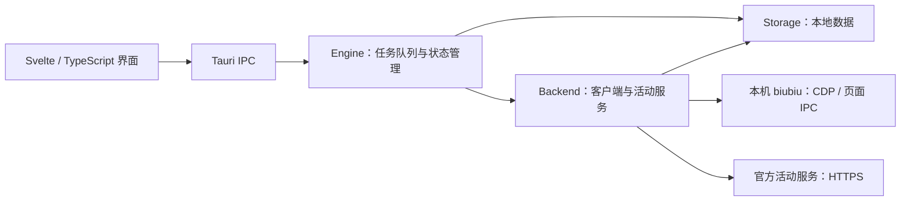

# 架构与协议说明

本文描述当前源码的组件职责、状态流转与外部协议约定。安装、使用和构建命令见 [README](../README.md)。远端字段来自客户端与活动页面的观察，不是稳定的官方 SDK；调整实现时应同时更新相应测试。

## 组件与入口



| 模块 | 职责 |
| --- | --- |
| [前端 IPC](../src/lib/ipc.ts) | 调用桌面命令，在普通浏览器中明确报错 |
| [桌面入口](../src-tauri/src/lib.rs) | 窗口、托盘、单实例、数据目录与命令注册 |
| [任务引擎](../src-tauri/src/engine.rs) | 串行执行、计时、停止、领取、抽奖及待核对状态 |
| [客户端后端](../src-tauri/src/backend.rs) | CDP 会话、客户端 IPC、活动 HTTPS 请求 |
| [平台集成](../src-tauri/src/client_platform.rs) | 安装识别、Windows 原生进程启动与按需提权 |
| [领域规则](../src-tauri/src/domain.rs) | 活动链接、任务解析、计划合并与有效计时 |
| [持久化](../src-tauri/src/storage.rs) | 文件锁、串行写入、原子替换、日志过滤与旧数据迁移 |

应用没有 Electron 主进程或本地 Node HTTP 服务。Node.js 仅用于开发、构建与测试；发行版的客户端连接不依赖 PowerShell 或旁置脚本。

| 桌面命令 | 行为 |
| --- | --- |
| `get_state` | 获取当前快照，不隐式连接客户端 |
| `dispatch` | 分发连接、会员刷新、活动读取、设置保存、任务启停及结果核对 |
| `detect_client_installations` | 只读识别本机安装，不保存设置 |
| `pick_client_directory` | 打开目录选择器，不保存设置 |
| `open_external` | 校验活动链接后交给系统浏览器 |
| `open_data_dir` | 打开实际数据目录 |
| `request_exit` | 停止任务并保存后退出 |

启动只加载本机缓存。公开内容和缓存不等于当前账号进度，需显式连接并核对账号。Cookie 与 CSRF 令牌只驻留 Rust 内存，不进入快照或持久化数据。

## 客户端连接与设置

桌面后端通过本机 `127.0.0.1:<端口>` 的 Chrome DevTools Protocol 连接 biubiu 主页面，再调用预加载脚本公开的 `window.ipc.send`。默认端口为 `9222`，合法范围为 `1–65535`。

[客户端设置](../src-tauri/src/client_settings.rs)持久化安装路径与端口。首次识别只读查询 HKCU/HKLM 的 App Paths、32/64 位卸载安装列表及常见目录。`client-settings` 操作验证 EXE 和端口，先保存，再清空旧会话与会员状态、更新任务租约端口；运行中、请求处理中、有待核对记录或自有遗留加速时不允许修改。保存设置不会启动客户端。

连接流程：

1. 尝试已有 CDP 页面；失败后通过临时绑定检查本机端口是否可用。端口占用或系统禁止绑定时返回具体错误，不盲目启动进程。
2. 需要启动时使用 Windows API；release 通过内嵌 manifest 请求管理员权限，开发版按需通过 `ShellExecuteExW/runas` 启动自身辅助模式。
3. 若需重启已有客户端，先按完整 EXE 路径确认目标，再显示默认取消的确认窗口，只处理所选安装对应的进程。
4. 以所选端口和回环地址启动客户端，检查早期退出并有界等待页面就绪，再建立会话。

子进程环境排除 `ELECTRON_RUN_AS_NODE`、`ELECTRON_NO_ASAR`、`NODE_OPTIONS`、`NODE_PATH`，不修改系统环境。连接事件记录阶段、端口与耗时，包括 `attach`、`attach-unavailable`、`launch`、`wait-renderer`、`renderer-ready`；不记录账号令牌、Cookie 或完整用户对象。

主要客户端命令：

| 命令 | 用途 |
| --- | --- |
| `get_active_center_info` | 读取活动中心条目 |
| `get-user-info` | 检查登录状态，并只提取会员到期时间与会员类型 |
| `update-user-info` | 用户点击会员刷新时，让客户端更新账号资料 |
| `search-game-list-combine` | 搜索 PC 游戏 |
| `get-games-by-ids`、`get-local-game-config` | 读取游戏、区服与加速模式 |
| `start-accelerate`、`get-accelerate-data`、`stop-accelerate` | 启动、核对与停止实际加速 |
| `open-webview` | 打开活动页面并沿用客户端会话 |

### 加速状态判定

`get-accelerate-data` 的顶层 `code` 是加速引擎结果，不是 IPC 成功码：

| 返回值 | 处理 |
| --- | --- |
| 缺少 `code` | 空闲或尚未确认，归一化为 `active: false, code: null` |
| 数值 `code: 0` 且游戏编号有效 | 确认正在加速，仍需核对目标游戏、区服及预检限制 |
| 非零结果码 | 保留加速失败结果 |

空闲、启动等待和停止重置可能返回 `{ bytes: 0, code: undefined, msg: "" }`，CDP 序列化后会省略 `code`，不能把缺字段当作成功。即使没有 `code`，仍保留 `checkSpeedUpInfo` 中的限制原因。

默认节点为 `{ id: "auto", displayName: "智能节点", type: 1 }`。停止操作仅针对本应用记录为拥有的加速任务。

### 会员状态

[会员解析](../src-tauri/src/membership.rs)读取 `fullMemberInfo.validTime`，为空时兼容 `fullPlatformMemberValidTime`，两者按毫秒时间戳解释；`fullMemberInfo.status` 的 `1` 为正式会员、`2` 为试用会员。

客户端侧仅投影登录布尔值、到期时间和会员类型，不返回完整用户对象、手机号或登录票据。桌面快照为 `membership: { expiresAt, kind, checkedAt }`，只驻留内存，退出登录或检测到连接失败时清空。`checkedAt` 是读取客户端的时间，不保证远端资料已更新。

显式 `membership` 操作先调用 `update-user-info` 再读取，不启动或重启客户端。界面统一使用 `Asia/Shanghai` 显示日期和秒，不从奖励天数猜算到期时间。

## 官方活动页面与请求

活动链接限定为：

```text
https://www.biubiu001.com/activity/activityTemplate?activityUuid=<活动编号>
```

页面公开信息可通过 HTTPS 读取；服务端渲染 HTML 中的 `window.__INITIAL_STATE__` 包含 `actInfo`、`actConfig` 和 `activityUuid`。活动中心列表则由 biubiu 客户端的原生网络模块读取，观察到的路径是 `/api/ping-server.active.pc.center.get?ver=1.0.0`，不是官网 H5 路径。

当前实现和记录中出现的活动操作：

| 路径 | 用途 |
| --- | --- |
| `/activity/activityTemplate` | 读取活动详情与任务状态 |
| `/activity/activityTemplate/reportTaskFinish` | 提交任务完成核验 |
| `/activity/activityTemplate/draw` | 使用已有抽奖次数 |
| `/activity/activityTemplate/getActiveAwardDetail` | 查询奖品详情 |
| `/activity/activityTemplate/myprizes` | 读取官方中奖记录 |

账号态请求使用客户端现有会话 Cookie、`csrfToken` 对应的 `x-csrf-token`、User-Agent、Origin 与 Referer。Cookie 值按 Chromium 返回的原值发送，兼容逗号、空格、引号、反斜杠及 UTF-8，不做二次编码；控制字符与分号仍会被拦截，域名、路径和有效期过滤保持生效。应用不保存账号密码或客户端登录令牌。远端业务状态与网络传输结果分开处理：如果写请求超时、响应格式无效或结果未知，会保留待核对状态，不自动重试；确认服务器状态后再执行重新读取。

## 任务执行与结果核对

自动计划仅处理可识别的 `type: 7` PC 加速时长任务；邀请、访问页面、绑定、手机加速及游戏内时间只展示说明。任务状态以服务端字段为准，历史累计 `finishCount` 不单独代表当日完成。

1. 按所选活动生成计划，同一游戏与区服合并执行，启动前核对账号和客户端状态。
2. 每 5 秒读取实际加速状态，只累计经过验证的有效区间；不把睡眠、卡顿或错误游戏产生的时间直接计入。
3. 达标后等待 20 秒结算缓冲，再读取服务端任务状态，处理符合条件的领取和已有次数的抽奖。
4. 写请求超时或结果未知时保存待核对状态，不自动重发。用户核对官方结果后重新读取，再决定下一步。

[任务租约](../src-tauri/src/lease.rs)与引擎操作锁协调客户端占用及并发请求；[存储层](../src-tauri/src/storage.rs)通过写队列和操作系统文件锁串行持久化。已有状态损坏时返回错误，不将其当作空记录覆盖。

## 本地数据生命周期

| 数据 | 持久化位置 |
| --- | --- |
| 客户端安装路径、调试端口 | `settings.json` |
| 活动缓存 | `activities.json` |
| 游戏、区服与时长映射 | `mappings.json` |
| 执行状态、奖品、待核对操作 | `run.json` |
| 过滤敏感字段后的事件日志 | `events.jsonl` |
| Cookie、CSRF、客户端会话、会员快照 | 仅进程内存 |

默认目录是 EXE 所在目录下的 `data\`；`AUTOBIUBIU_DATA_DIR` 可覆盖。已有 `settings.json` 优先于 `AUTOBIUBIU_CDP_PORT`，后者仅用于首次配置。

首次迁移只在目标目录不存在时复制上表五个文件，不删除来源、不覆盖已有目标。来源优先级为 `AUTOBIUBIU_LEGACY_DATA_DIR`、存在的 `%APPDATA%\AutoBiubiu\data`，最后为开发版源码根目录的旧数据或发行版 EXE 旁的历史数据。[启动脚本](../scripts/launch.ps1)会显式选择源码根目录旧数据；冒烟模式完全禁用迁移。

日志过滤不等于所有业务数据可以公开：奖品与待核对记录可能包含兑换信息。数据目录、验证输出和历史样本应保持在版本控制之外。

## 验证与维护

- 前端测试位于 [test/frontend.test.ts](../test/frontend.test.ts)，覆盖活动筛选、任务配置、时间显示和输入校验。
- Rust 测试位于各模块的测试区，覆盖协议归一化、任务计时、状态持久化、迁移和结果不明处理。
- [桌面冒烟测试](../scripts/smoke-desktop.js)使用显式 `--smoke-test` 隔离目录，检查真实窗口、IPC、单实例和退出保存，只允许隔离配置保存，阻止其他业务操作。
- [启动脚本测试](../test/launch.test.ps1)和[旧配置归档测试](../test/cleanup-profile.test.ps1)使用临时目录，不操作真实业务数据。

本地测试和构建不替代真实客户端登录、游戏加速及官方活动服务核验。远端协议变化时，优先用去除账号信息的最小合成数据补充回归测试，不将抓取的客户端脚本、会话或活动兑换记录加入仓库。
